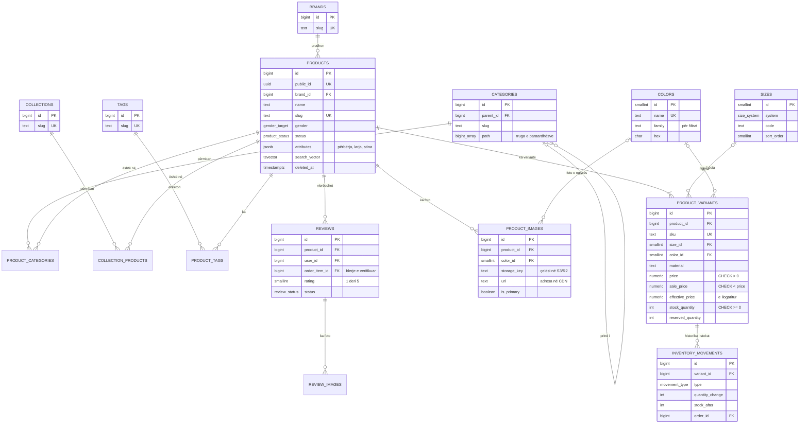
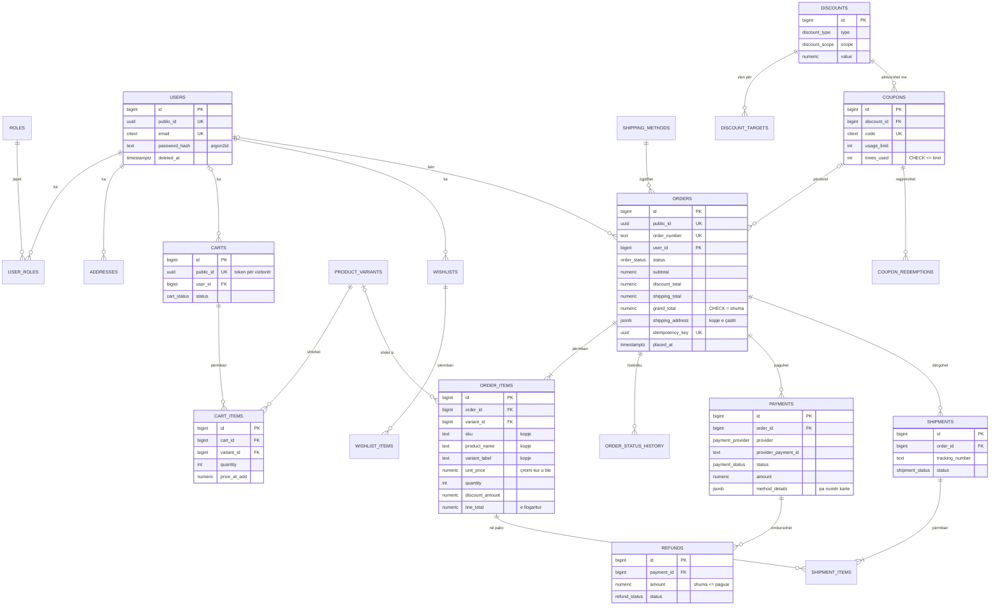

# M’DON: databaza PostgreSQL për e-commerce të madh rrobash

Skemë për një dyqan online me meshkuj, femra dhe fëmijë, e menduar për mijëra blerës njëkohësisht. Stoku dhe çmimi mbahen për çdo variant (SKU), dhe asnjë copë nuk shitet dy herë.

| Skedari | Çfarë ka |
|---|---|
| [01_schema.sql](01_schema.sql) | Tabelat, constraints, indekset, triggerët, funksionet e stokut dhe të porosisë |
| [02_seed.sql](02_seed.sql) | Të dhëna shembull: 3 produkte me 20 variante, përdorues, porosi me kupon, pagesë, dërgesë, vlerësim |
| [03_queries.sql](03_queries.sql) | 5 query-t kryesore: filtrimi, krijimi i porosisë, ulja e stokut, raportet, më të shiturat |
| [04_tests.sql](04_tests.sql) | 16 kontrolle që provojnë rregullat (stoku, çmimi, statusi, rimbursimet…), me ROLLBACK në fund |
| [05_partitioning_orders.sql](05_partitioning_orders.sql) | Shembull i particionimit të porosive sipas muajit |

```bash
createdb mdon
psql -d mdon -v ON_ERROR_STOP=1 -f 01_schema.sql -f 02_seed.sql
psql -d mdon -f 03_queries.sql     # query-t
psql -d mdon -f 04_tests.sql       # kontrollet: çdo rresht duhet ok = t
```

Synon **PostgreSQL 18** (`uuidv7()`). Në versionet 15–17 zëvendëso `uuidv7()` me `gen_random_uuid()`. Të gjithë skedarët janë ekzekutuar dhe testuar në PostgreSQL 18.6.

---

## 1. Diagrama ER

### Katalogu dhe inventari



### Klientët, shporta, porositë dhe pagesat



---

## 2. Çelësat primarë: BIGINT + UUID publik

- **Brenda databazës: `BIGINT GENERATED ALWAYS AS IDENTITY`.**
  - Zë 8 bajt në vend të 16, kështu që indekset dalin më të vogla dhe JOIN-et më të shpejta.
  - Rreshtat e rinj shtohen në fund të indeksit B-tree.
  - Kjo ka rëndësi te tabelat me miliona rreshta: `order_items`, `inventory_movements`, `cart_items`.
- **Jashtë (URL, API, email): `public_id UUID DEFAULT uuidv7()`**, te `users`, `products`, `carts`, `orders`, `wishlists`.
  - Askush nuk mund të provojë `/porosia/1001`, `/porosia/1002`… për të parë porositë e të tjerëve.
  - UUIDv7 renditet sipas kohës, prandaj nuk e fragmenton indeksin si UUIDv4.
- **UUIDv7 si çelës primar** do të vlente nëse ID-të krijoheshin jashtë databazës, ose nëse shkruhej në disa rajone njëkohësisht. Për një databazë kryesore me replika, BIGINT është më i lehtë.

## 3. Vendimet kryesore të skemës

- **Stoku dhe çmimi te varianti.**
  - Kolonat: `stock_quantity`, `reserved_quantity`, `price`, `sale_price`.
  - `effective_price = coalesce(sale_price, price)` është kolonë e llogaritur dhe e indeksuar, prandaj filtri i çmimit përdor indeks.
  - Rregullat: `CHECK (stock_quantity >= 0)`, `CHECK (price > 0)` dhe `CHECK (sale_price < price)`.
- **Atributet në JSONB.** Përbërja, larja, stina dhe origjina ruhen te `products.attributes`, me indeks GIN (`jsonb_path_ops`). Query i tipit `attributes @> '{"stina":["dimer"]}'` e përdor indeksin.
- **Kategoritë hierarkike** ruhen si `parent_id` + `path BIGINT[]`, të mbushur nga një trigger.
  - "Gjithçka nën Femra" bëhet me `path @> ARRAY[id]`, me indeks GIN dhe pa query rekursive.
  - Kur zhvendoset një kategori, triggeri përditëson të gjithë nënpemën. Ciklet refuzohen.
- **Madhësitë dhe ngjyrat janë tabela më vete.**
  - Madhësitë renditen saktë (XS < S < M, 38 < 39), jo sipas alfabetit.
  - Ngjyrat kanë një "familje" për filtrat: "Bordo" dhe "Gjak" bien të dyja te "kuqe".
- **Fotot ruhen si URL CDN + `storage_key`.** Mund të ketë disa foto për çdo ngjyrë, me një foto kryesore për çdo produkt × ngjyrë (indeks unik i pjesshëm).
- **Kopja e çastit te porosia.**
  - `order_items` ruan `sku`, `product_name`, `variant_label`, `image_url` dhe `unit_price` ashtu siç ishin në momentin e blerjes.
  - `orders.shipping_address` është kopje JSONB e adresës.
  - Ndryshimet e mëvonshme në katalog nuk e prekin faturën.
- **Fshirja e butë (`deleted_at`)** vlen për përdoruesit, adresat, produktet, variantet, kategoritë, markat, koleksionet, etiketat, kuponët dhe vlerësimet.
  - Indekset unike janë të pjesshme (`WHERE deleted_at IS NULL`), që i njëjti email ose slug të mund të përdoret sërish.
  - **Porositë, pagesat dhe librat nuk fshihen kurrë**, sepse janë dokumente financiare. Për to përdoret statusi.
- **Rregullat e biznesit mbrohen nga vetë databaza**, me trigger-ë dhe constraints:
  - kalimet e lejuara të statusit të porosisë (një porosi e dorëzuar nuk kthehet "në pritje")
  - historiku automatik i statusit, me personin që e ndryshoi (`SET LOCAL app.user_id`)
  - rimbursimet nuk kalojnë shumën e paguar
  - libri i inventarit dhe historiku vetëm shtohen, nuk ndryshohen e as fshihen
  - limiti i kuponit mbrohet me `CHECK (times_used <= usage_limit)`
  - `grand_total = subtotal − zbritja + transporti + taksa`
- **`updated_at`** mbahet nga triggeri për çdo tabelë që e ka këtë kolonë.

## 4. Si parandalohet shitja e stokut që nuk ekziston

`create_order_from_cart()` e bën gjithçka në një transaksion. [03_queries.sql](03_queries.sql) e tregon nga hapi në hap.

1. **Bllokohet shporta** (`SELECT … FOR UPDATE`). I njëjti klient nuk mund ta paguajë dy herë nga dy skeda.
2. **Bllokohen variantet** (`SELECT … FOR UPDATE ORDER BY id`). Renditja është gjithmonë e njëjtë, që dy porosi me të njëjtat produkte të mos bllokojnë njëra-tjetrën (deadlock).
3. **Stoku kontrollohet mbi rreshtat e bllokuar.** Klienti i dytë pret derisa i pari të bëjë `COMMIT`. Pastaj sheh stokun e ri dhe merr "Stok i pamjaftueshëm".
4. **Stoku ulet dhe shkruhet `inventory_movements`** në të njëjtin transaksion.
5. **`CHECK (stock_quantity >= 0)`** është vija e fundit e mbrojtjes, nëse ndonjë kod tjetër gabon.
6. **`idempotency_key`** (UNIQUE): klikimi dy herë te "Paguaj" krijon vetëm një porosi.

```
Sesioni A (klienti 1)                          Sesioni B (klienti 2)
BEGIN;                                         BEGIN;
SELECT … FOR UPDATE   ← bllokon SKU-në
                                               SELECT … FOR UPDATE   ← PRET
stoku 1 → 0; INSERT porosia; COMMIT;
                                               zgjohet: stoku 0 → "Stok i pamjaftueshëm"; ROLLBACK
```

Për ndryshime të thjeshta stoku (shitje në dyqanin fizik) mjafton një `UPDATE … SET stock = stock − n WHERE stock − reserved >= n` atomik, i shkruar në `adjust_stock()` dhe në query 3a. Në flash sale me shumë blerës për të njëjtën SKU, rezervimi bëhet më parë në Redis, dhe vetëm ata që kalojnë hyjnë në checkout (seksioni 5).

**Prova me dy sesione në një server të vërtetë.** Hap dy dritare `psql`. PGlite, ku u testua kjo skemë, ka vetëm një lidhje, prandaj ky test duhet bërë në server.

```sql
-- Dritarja 1                                   -- Dritarja 2
BEGIN;                                          BEGIN;
SELECT stock_quantity FROM product_variants
 WHERE sku = 'MD-XHM-BAR-L' FOR UPDATE;
                                                SELECT stock_quantity FROM product_variants
                                                 WHERE sku = 'MD-XHM-BAR-L' FOR UPDATE;   -- mbetet në pritje
UPDATE product_variants SET stock_quantity = 0
 WHERE sku = 'MD-XHM-BAR-L';
COMMIT;                                         -- tani merr përgjigje: 0
```

## 5. Arkitektura

```
Shfletuesi ──► CDN (Cloudflare) ──► fotot nga S3 / R2
     │
     ▼
 Aplikacioni (Node, shumë instanca) ──► Redis      (cache, shporta, sesionet, rezervimet)
     │            │
     │            └────────────────────► Meilisearch (kërkimi dhe filtrat)
     ▼                                        ▲
 PgBouncer ──► PostgreSQL kryesor ──outbox──► worker
                      │
                      └── replikime ──► Read replica(s) (katalogu, raportet)
```

### Redis: cache, shporta, sesionet

- **Cache.** Faqet e produkteve dhe listat e kategorive ruhen si JSON, me TTL 5–15 minuta. Kur një produkt ndryshon, triggeri shkruan te `outbox_events`, dhe worker-i fshin çelësat e cache-it. Nuk ka të dhëna të vjetra pa fund.
- **Shporta e vizitorëve.** Ruhet si `HASH cart:{public_id}` (variant → sasi), me TTL 30 ditë. Te PostgreSQL shkruhet vetëm kur klienti kyçet ose arrin te checkout-i. Kështu databaza nuk merr çdo klikim "Shto në shportë".
- **Sesionet.** `SET session:{token}` me TTL. Token-i rinovohet pas hyrjes, dhe sesionet fshihen kur ndërrohet fjalëkalimi.
- **Flash sale.** Stoku i një SKU-je të nxehtë kopjohet në një numërues Redis. Një skript Lua bën `DECRBY` vetëm nëse ka mjaftueshëm, dhe vetëm blerësit që kalojnë marrin `reserved_quantity` dhe hyjnë në `create_order_from_cart()`. PostgreSQL mbetet burimi i së vërtetës.
- **Kufizim kërkesash** (rate limiting) për hyrjen, checkout-in dhe kuponët.

### Meilisearch (ose Elasticsearch): kërkimi me filtra

- **Një dokument për çdo produkt**, i rrafshuar: emri, përshkrimi, marka, rruga e kategorive, `sizes_in_stock[]`, `colors[]`, `min_price`, `on_sale`, atributet e stinës dhe vlerësimi mesatar.
- **Fushat:** `filterableAttributes` për kategorinë, markën, madhësinë, ngjyrën, çmimin, gjininë dhe stinën; `sortableAttributes` për çmimin, datën dhe shitjet. Facet-et (p.sh. "M (12)") dalin falas.
- **Sinkronizimi bëhet përmes `outbox_events`.** Ndryshimi shkruhet në të njëjtin transaksion me produktin, worker-i e lexon me `FOR UPDATE SKIP LOCKED`, përditëson dokumentin dhe e shënon `processed_at`. Asnjë ndryshim nuk humbet, edhe nëse Meilisearch bie për pak.
- **Kërkimi kthen ID-të**, ndërsa çmimi dhe stoku i fundit lexohen nga Redis/PostgreSQL në faqen e produktit dhe në checkout. Kurrë nuk shitet sipas indeksit të kërkimit.
- **Elasticsearch/OpenSearch** vlen kur katalogu kalon disa milionë produkte, ose kur duhen analitika dhe rregulla të avancuara rëndimi. Meilisearch është më i thjeshtë për t'u mbajtur dhe toleron gabimet e shkrimit.

### S3 / Cloudflare R2 + CDN: fotot

- **Ngarkimi bëhet direkt** nga paneli në S3/R2, me presigned URL. Serveri nuk i kalon bajtet përmes vetes, dhe në databazë ruhen vetëm `storage_key` dhe `url`.
- **Emrat e skedarëve kanë hash** (`xhamadan-zeze-1.a8f3c2.jpg`), me `Cache-Control: public, max-age=31536000, immutable`. Një foto e re merr emër të ri, kështu që cache-i nuk duhet pastruar kurrë.
- **Madhësitë dhe formatet** (`?w=400&format=avif`) krijohen nga Cloudflare Images ose imgproxy. Ruhet një origjinal për çdo foto.
- **R2 nuk ka kosto egress-i.** Kjo vlen kur trafiku i fotove është i madh.

### Read replicas dhe particionimi

- **Replikat.** Katalogu, raportet dhe paneli lexojnë nga replikat (streaming replication). Checkout-i, stoku dhe pagesat shkruajnë dhe lexojnë vetëm nga serveri kryesor.
- **Vonesa e replikimit.** Faqja "Faleminderit për porosinë" dhe "Porositë e mia" menjëherë pas blerjes lexojnë nga serveri kryesor (read-your-writes).
- **PgBouncer** në transaction mode: mijëra lidhje të aplikacionit kalojnë në ~50–100 lidhje reale.
- **Particionimi i `orders` sipas muajit** ([05_partitioning_orders.sql](05_partitioning_orders.sql)) bëhet kur tabela kalon ~50–100 milionë rreshta, jo që në ditën e parë.
  - Query-t me interval datash lexojnë vetëm muajt që duhen. U testua: muaji i kaluar përjashtohet nga plani.
  - Muajt e vjetër arkivohen me `DETACH PARTITION` në vend të `DELETE`.
  - Çmimi: çelësi primar bëhet `(id, placed_at)`, dhe `order_items` mban edhe `order_placed_at` për çelësin e huaj.
  - E njëjta vlen për `inventory_movements` dhe `order_status_history`, që rriten njësoj.
  - Particionet krijohen me `pg_partman` ose një cron mujor.

## 6. Query-t kryesore ([03_queries.sql](03_queries.sql))

1. **Filtrimi i produkteve:**
   - kategoria me nënkategoritë, gjinia, çmimi, madhësitë, ngjyrat dhe marka
   - atribute JSONB, vetëm në stok
   - faqosje *keyset* `(çmimi, id) > (…)`, që mbetet e shpejtë edhe në faqen 500, ndryshe nga `OFFSET`
2. **Krijimi i porosisë:** `create_order_from_cart()` me kupon dhe çelës idempotency, brenda `BEGIN … COMMIT`.
3. **Ulja e stokut:** (a) UPDATE atomik + libri në një query, (b) `SELECT … FOR UPDATE` kur duhet logjikë në mes.
4. **Raportet:** shitjet ditore (edhe ditët me 0), sipas kategorisë kryesore me përqindje, muaj pas muaji me rritjen.
5. **Më të shiturat:** copët, të ardhurat, porositë, varianti më i shitur (`mode()`) dhe stoku që ka mbetur.

## 7. Këshilla për performancë

- **Indekset ndjekin filtrat.**
  - Kategoria: GIN mbi `path`.
  - Madhësia dhe ngjyra: `(size_id, product_id)`, `(color_id, product_id)`.
  - Çmimi: `effective_price`. Marka, gjinia, statusi + data: B-tree.
  - Teksti: `tsvector` + `pg_trgm`. Atributet: GIN `jsonb_path_ops`.
  - Raportet: BRIN mbi `placed_at`, i vogël dhe ideal për të dhëna që shtohen sipas kohës.
- **Indekse të pjesshme** (`WHERE deleted_at IS NULL`): më të vogla dhe më të shpejta, sepse rreshtat e fshirë nuk kërkohen kurrë.
- **HOT updates për stokun.**
  - `product_variants` ka `fillfactor = 85`, dhe stoku me qëllim **nuk indeksohet**.
  - Kështu çdo shitje përditëson rreshtin pa prekur indekset, që ka rëndësi kur një SKU shitet qindra herë në minutë.
  - Filtri "vetëm në stok" në shkallë të madhe bëhet në Meilisearch.
- **Transaksione të shkurtra.** Checkout-i nuk thërret shërbime të jashtme (pagesën) brenda transaksionit që mban bllokimet: porosia krijohet `pending_payment`, dhe pagesa konfirmohet me webhook në një transaksion tjetër.
- **Kufij kohe:** `statement_timeout` (p.sh. 5s për faqet, më shumë për raportet në replika), `lock_timeout = 2s` në checkout, dhe `idle_in_transaction_session_timeout`.
- **Rezervimet e skaduara.** Kur stoku rezervohet në checkout, një job lirohet `reserved_quantity` pas 15 minutave pa pagesë.
- **Monitorimi:**
  - `pg_stat_statements` tregon query-t më të ngadalta, dhe `auto_explain` planet e tyre.
  - Për tabelat e nxehta (`product_variants`, `carts`) duhet akorduar autovacuum.
- **Raportet e rënda** shkojnë në replikë ose në materialized views që rifreskohen me `REFRESH MATERIALIZED VIEW CONCURRENTLY` çdo disa minuta.

## 8. Këshilla për siguri

- **Role me privilegje minimale:**
  - `app_rw` lexon/shkruan vetëm tabelat që i duhen, pa `DROP` e pa `TRUNCATE`.
  - `app_ro` lexon nga replikat, vetëm për katalogun dhe raportet.
  - `migrator` përdoret vetëm për migrime.
  - Asnjë rol nuk ka `UPDATE`/`DELETE` mbi `inventory_movements` dhe `order_status_history`. Edhe triggeri e ndalon.
- **Gjithmonë prepared statements** (`$1, $2`), që mbrojnë nga SQL injection. Query-t e këtyre skedarëve janë shkruar me parametrat në një CTE pikërisht për këtë arsye.
- **Fjalëkalimet me argon2id**, me kripë, në aplikacion. Databaza nuk sheh kurrë fjalëkalimin e lexueshëm.
- **Kartat nuk ruhen kurrë.** Pagesat bëhen përmes ofruesit (Stripe/POK), dhe `payments.method_details` mban vetëm markën dhe 4 shifrat e fundit. Kështu dyqani mbetet jashtë fushës së rëndë PCI-DSS.
- **Webhook-et e pagesave:**
  - verifikohen me nënshkrim
  - `UNIQUE (provider, provider_payment_id)` mbron nga përsëritjet
  - statusi ndryshon vetëm sipas kalimeve të lejuara
- **Të dhënat personale (GDPR):**
  - TLS dhe enkriptim i diskut, me backup-e të enkriptuara.
  - Kur fshihet llogaria, `deleted_at` vendoset dhe të dhënat personale anonimizohen.
  - Porositë mbeten me `user_id = NULL` për kontabilitetin.
- **Backup:**
  - backup i vazhdueshëm me WAL (PITR, p.sh. me pgBackRest)
  - provë rikthimi çdo muaj
  - replikë në një zonë tjetër
- **Auditimi:**
  - Ndryshimet e statusit regjistrohen me personin përgjegjës (`app.user_id`).
  - Ndryshimet e çmimeve dhe të stokut mbeten në `inventory_movements` dhe `outbox_events`.
- **Kufij te aplikacioni:** rate limiting për hyrjen, kuponët dhe krijimin e porosive, që mbron nga provat e kodeve dhe nga botët që blejnë gjithë stokun e një flash sale.
- **Rrjeti:** PostgreSQL nuk del në internet. Lidhja bëhet vetëm nga rrjeti privat i aplikacionit, me `pg_hba.conf` të kufizuar dhe `scram-sha-256`.

## 9. Si u testua

Të gjithë skedarët u ekzekutuan me radhë në **PostgreSQL 18.6** (PGlite) pa asnjë gabim:

- **Porosia me kupon** del e saktë: 65.700 L − 10% vetëm te artikujt e koleksionit (5.280 L, e ndarë sipas rreshtave) + transport falas = 60.420 L.
- **Stoku** i çdo varianti përputhet me shumën e lëvizjeve në libër.
- **[04_tests.sql](04_tests.sql):** 16/16 kontrolle kalojnë:
  - copa e fundit shitet vetëm një herë
  - stoku dhe çmimi refuzojnë vlerat e pavlefshme
  - SKU dhe slug-u janë unikë
  - kalimet e palejuara të statusit refuzohen
  - rimbursimet nuk kalojnë shumën e paguar
  - libri vetëm shtohet
  - kategoritë nuk lejojnë cikle dhe nënpema ndjek prindin
  - limiti i kuponit mbahet
  - idempotency funksionon
- **Particionimi:** porositë bien në muajin e duhur, dhe plani përjashton muajt që nuk duhen.

Pritja reale e dy sesioneve në `FOR UPDATE` është sjellja standarde e PostgreSQL. Për ta parë me sy, përdor provën me dy dritare në seksionin 4.
